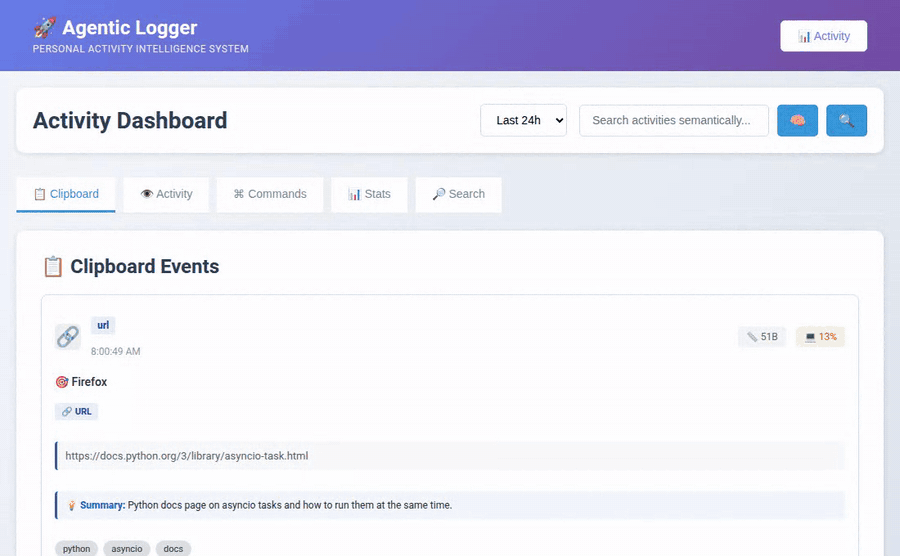
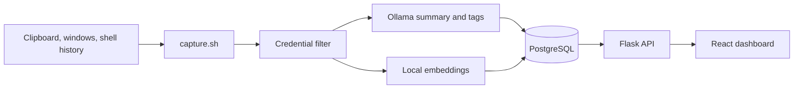

<div align="center">

# agentic-logger



**Searchable history of your clipboard, windows and shell commands, on your own machine.**

[](https://github.com/jayhemnani9910/agentic-logger/actions/workflows/ci.yml)
[](https://github.com/jayhemnani9910/agentic-logger/releases)
[](LICENSE)

[](CONTRIBUTING.md)

[Install](#install) · [What it captures](#what-it-captures) · [How it works](#how-it-works) · [Privacy](#privacy) · [Contributing](CONTRIBUTING.md)

</div>

## Install

Needs Docker with Compose v2.

```bash
git clone https://github.com/jayhemnani9910/agentic-logger && cd agentic-logger && ./setup.sh
```

The dashboard is now at <http://localhost:3000>.

## Start capturing

Capture runs on your machine, outside Docker, so it can see your desktop. Needs [uv](https://docs.astral.sh/uv/) or Python 3.11.

```bash
./capture.sh
```

The first run installs its dependencies, which takes a few minutes. Copy something, run a command, then open the dashboard.

For summaries and tags, install [Ollama](https://ollama.com) and pull the default model:

```bash
ollama pull qwen3.5:4b
```

Everything else works without it.

## What it captures

| What | How | Needs on Linux |
|---|---|---|
| Clipboard text | Checked once a second | `xclip`, or `wl-clipboard` on Wayland-only sessions |
| Copied images | Text read with OCR, image kept on disk | `tesseract-ocr` |
| Active window on X11 | Checked every 5 seconds | `xdotool` |
| Active window on GNOME Wayland | Checked every 5 seconds | The [Window Calls](https://extensions.gnome.org/) GNOME extension |
| Shell commands | New lines in your bash or zsh history | Nothing extra |

Exit codes show as unknown, because shell history does not record them.
Other Wayland desktops are not supported for window tracking yet.

## How it works



Search in two ways from the dashboard. Press Enter to search by meaning, or Shift+Enter to match exact words.

## Privacy

> [!WARNING]
> This tool records what you copy and the commands you run, and stores them unencrypted in a local database. Only run it on a machine you trust.

- Nothing leaves your machine. Summaries use your local Ollama, and embeddings run locally after a one-time model download.
- Text that looks like a credential, such as `password=...`, API tokens and private keys, is replaced with a placeholder before saving. The filter works on patterns, so a bare password copied from a password manager is **not** caught.
- All ports are published on `127.0.0.1` only. The API has no login, so do not expose it to a network.

## Configuration

Copy `.env.example` to `.env` to change a setting. All are optional.

| Variable | Default | Used for |
|---|---|---|
| `OLLAMA_MODEL` | `qwen3.5:4b` | Model for summaries and tags |
| `OLLAMA_URL` | `http://localhost:11434` | Where Ollama runs |
| `POSTGRES_PASSWORD` | `postgres` | Database password |
| `POSTGRES_URL` | Local Docker database | Database that capture writes to |
| `CORS_ORIGINS` | `http://localhost:3000` and `http://127.0.0.1:3000` | Pages allowed to call the API |
| `IMAGE_DIR` | `~/.local/share/agentic_logger/images` | Where copied images are kept |

## API

| Endpoint | Purpose |
|---|---|
| `GET /api/clipboard`, `/api/activity`, `/api/commands` | List captured events |
| `GET /api/clipboard/<id>/details` (also `activity`, `commands`) | One event in full |
| `POST /api/search` | Search everything captured |
| `POST /api/search/semantic`, `/api/search/keywords` | Search the clipboard |
| `GET /api/stats` | Capture counts and top apps |
| `POST /api/events`, `GET /api/events` | Log events from your own agents |
| `POST /api/sessions`, `GET`/`PUT /api/sessions/<agent_id>` | Track agent sessions |
| `GET /health` | Health check |

## Contributing

Bug reports and pull requests are welcome, and I reply to issues within 24 hours. See [CONTRIBUTING.md](CONTRIBUTING.md) to get set up.

## License

[MIT](LICENSE)
